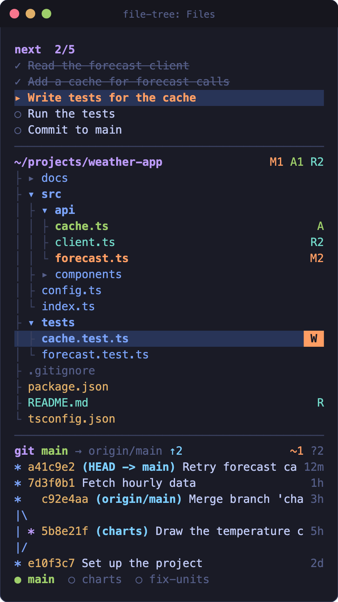
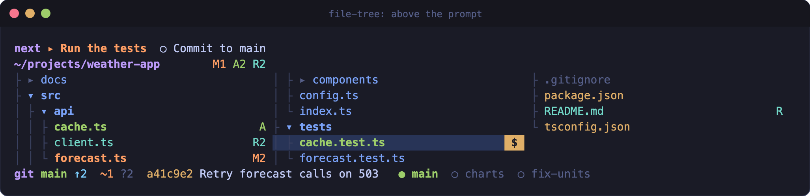

# claude-mods

Mods for Claude Code: small plugins that change its interface while you work.

| Mod | What it does |
| --- | --- |
| [file-tree](mods/file-tree/README.md) | A side pane or band with a tree of the working folder that shows, live, what Claude reads, writes and plans next, plus the repository's git graph and a branch switcher. The legend for its marks (`M2 A3 R1`, the ` R ` ` W ` ` S ` ` $ ` badges, the plan and git glyphs) is in its README. |

<p align="center">
  
</p>

<p align="center">
  
</p>

## Install

This repository is private: you need access to it on GitHub, and git on your computer signed in to GitHub (for example with `gh auth login`).

At the prompt of a Claude Code terminal session:

```
/plugin install file-tree --marketplace psh9/claude-mods
```

Answer `y` to add the marketplace, then pick a scope (user, to have it in every project).

From a shell:

```
claude plugin install file-tree --marketplace psh9/claude-mods
```

## Developing

Each mod is a folder under `mods/`, listed in `.claude-plugin/marketplace.json`. Run one from its folder with `claude --plugin-dir mods/<mod>`, check it with `claude plugin validate mods/<mod>`, and run its tests with `claude plugin test mods/<mod>`.
