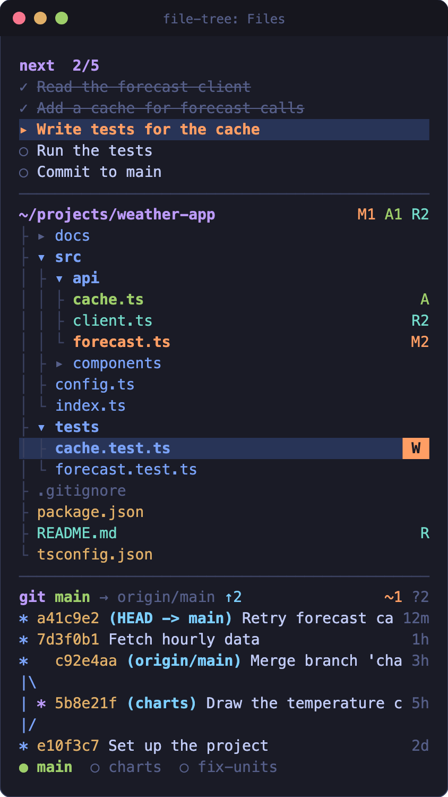
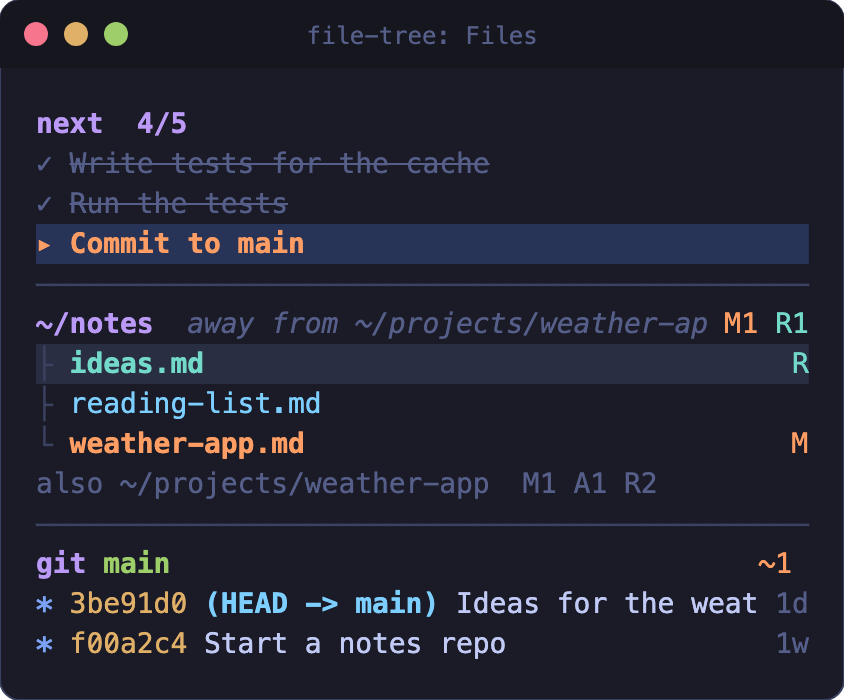
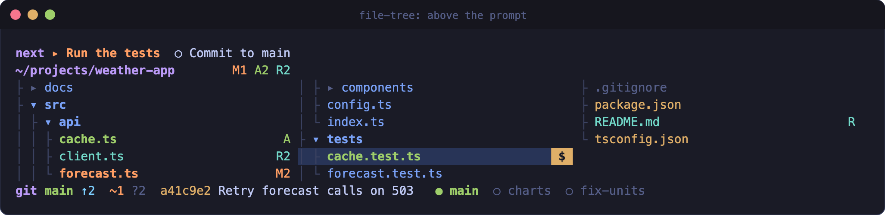

# file-tree

A pane beside the chat (or a band above the prompt) with a tree of the folder Claude is working in, styled after nvim-tree with Tokyo Night colors. It follows Claude as it works: what it reads, what it writes, where it goes, what it plans to do next, where the repository stands in git, and how the conversation has branched with `/branch`.

## Screenshots

<table>
<tr>
<td valign="top" width="50%">

**The side pane, while Claude writes a file.** The plan on top, the tree with the file being written badged ` W `, and the git graph with branch chips at the bottom.



</td>
<td valign="top" width="50%">

**Following Claude to another project.** Claude edited a file in `~/notes`, so the tree moved there; the `also` line keeps the tally of the project it left.



</td>
</tr>
</table>

**The band above the prompt** (`/file-tree band`), while a shell command runs the tests:



The screenshots are drawn from the mod's own output: `tests/screenshots.test.tsx` plays these scenes on a sample project, and `scripts/render-screenshots.py` turns each drawing into the images in `docs/` (see [Developing](#developing)).

## Legend

### Header

The top line of the tree is the folder it shows, with totals for that folder on the right:

| Total | Means |
| --- | --- |
| `M2` | 2 files modified (existing files Claude edited) |
| `A3` | 3 files added (files Claude created) |
| `R1` | 1 file read and not changed |

A file counts once, by its strongest mark: a file read and then edited counts as `M`.

`away from ~/your-folder` after the folder name means the tree has followed Claude out of the folder the session started in. See [Following Claude](#following-claude).

### Badges: what is happening now

While a tool is working on a path, its row turns blue and wears a colored badge on the right:

| Badge | Color | Means |
| --- | --- | --- |
| ` R ` | teal | reading the file |
| ` W ` | orange | writing the file (an edit, a new file, a shell command writing to it) |
| ` S ` | purple | searching in it (Grep or Glob) |
| ` $ ` | yellow | a shell command working in that folder or on that path, its effect unknown |

When the call ends, the last row touched keeps a softer highlight for 8 seconds, so a fast read or write is still easy to spot.

### Marks: what happened this session

After the call, a plain letter stays on the row:

| Mark | Color | Means |
| --- | --- | --- |
| `M` | orange | modified: the file existed and was edited |
| `A` | green | added: the file was created this session |
| `R` | teal | read, not changed |

A number after the letter counts repeats: `M3` is a file edited three times, `R2` a file read twice. A modified or added file's name is bold and takes the mark's color.

### Tree

| Glyph | Means |
| --- | --- |
| `▾ name` | an open folder: something inside it was touched |
| `▸ name` | a closed folder |
| `├ └ │` | tree lines |
| `N more` | entries left out: a folder shows its first 30 entries, plus every one that matters |
| `↑ N more` / `↓ N more` | the tree is taller than the pane, so it shows the part around the active file |

Folders open by themselves along the path to whatever Claude touched. `.git`, `node_modules`, `__pycache__`, `.venv` and similar folders are hidden unless something inside them was touched.

File names are colored by type, roughly as nvim-web-devicons does: `.py` yellow, `.ts`/`.tsx` blue, `.md` cyan, `.sh` green, `.toml`/`.yaml` purple, dotfiles grey.

### Plan

When Claude lays out steps, it calls the mod's `plan` tool and the steps show above the tree:

| Glyph | Means |
| --- | --- |
| `next  1/3` | steps done out of the whole plan |
| `▸` (orange, highlighted) | the step in progress |
| `○` | a step still to come |
| `✓` (struck through) | a step done; the last two stay in view |

In the band layout the plan is one line: `next ▸ Commit to main  ○ Push ...`.

### Chats

Under the plan, the conversation's branches. A conversation never branched is `Root` alone. Each `/branch` (or `/fork`) adds the new conversation under the one it came from:

```
chats  2 branches
○ Root                              7 prompts
├ ○ try-a                   shares 3 · 5 prompts
│   ⑂ after "create a new branch and build the feature"
└ ● try-b  here             shares 5 · 6 prompts
    ⑂ after "now the README"
```

| Part | Means |
| --- | --- |
| `●` (green) `here` | the conversation this session is in |
| `○` | another conversation of the same tree |
| `├ └ │` | which conversation a branch was made from |
| `shares 3` | the branch was made after the parent's 3rd prompt: those 3 prompts and their answers are context both hold |
| `5 prompts` | prompts in the conversation, the shared ones included, as of the last time it was open |
| `⑂ after "..."` | the last prompt before the fork |

A branch is named by what follows `/branch` (`/branch try-a`), else `branch 1`, `branch 2`, ... The tree is kept across sessions, so resuming any conversation of it (`claude --resume`) shows the whole tree again. In the band layout it is one line: `chat Root › try-b  shares 5 of 6 prompts  2 branches`.

### History

Under the chats, the prompts of the conversation this session is in, numbered, the latest six in view:

```
history  12 prompts                        ↑6
 7 create a new branch and build the feature
   ⑂ branched here
 8 now the README
 9 commit it
```

| Part | Means |
| --- | --- |
| `7 ...` | the 7th prompt, its first line |
| dim prompt | shared with the conversation this one branched from |
| `⑂ branched here` | where `/branch` made this conversation |
| `↑6 ↓2` | prompts above and below the ones in view |

Click a prompt to open it: its whole text shows, then the start of Claude's answer after `⏺`. Click it again to close it. With the pane focused, `c` puts the cursor in the history: `j` / `k` (or `n` / `p`) step to the next or earlier prompt, `l` opens it, `h` closes it (and again goes back to the tree), `a` puts the prompt back in the prompt box to edit or ask again, `y` copies it, `x` or `f` returns to the latest. The transcript itself does not scroll: a mod cannot move it.

In the band layout the history shows the latest three prompts under the `chat` line; a click opens one there the same way.

### Footer

`also ~/other-folder  M1 R4` lines list the other folders touched this session, with their totals, so nothing drops out of sight when the tree moves.

### Git

Under the tree, for the repository the tree shows (nothing outside one):

```
git main → origin/main ↑2                ~1 ?2
* a41c9e2 (HEAD -> main) Retry forecast ca 12m
*   c92e4aa (origin/main) Merge branch 'cha 3h
|\
| * 5b8e21f (charts) Draw the temperature c 5h
|/
* e10f3c7 Set up the project                2d
● main  ○ charts  ○ fix-units
```

| Part | Means |
| --- | --- |
| `git main` | the branch checked out |
| `→ origin/main` | the branch it tracks |
| `↑2` (cyan) | 2 commits not pushed yet |
| `↓1` (red) | 1 commit on the remote not pulled yet |
| `+3` (green) | 3 files staged |
| `~1` (orange) | 1 file changed, not staged |
| `?2` (grey) | 2 untracked files |
| `clean` (green) | nothing to commit |
| `* a41c9e2` | a commit on the graph: its short hash (yellow), its branches and tags (cyan), its message, and how long ago (`12m`, `3h`, `2d`, `1w`) |
| `\|\ \|/` | where branches fork and merge, colored per column as `git log --graph` draws them |

The graph shows the last 6 commits. It is read again after every shell command and every write, and at most every few seconds otherwise.

### Branches

The last row is a chip per local branch, the most recently committed first: `●` (green) is the one checked out, `○` the others. Click a chip (or focus the pane with `ctrl+x` then `tab`, move to it with Tab and press Enter) to run `git switch <branch>` in that repository; a toast says whether it worked, and why not when it did not (uncommitted changes in the way, for one). Claude is not told of the switch, so mention it if Claude is in the middle of something.

In the band layout, git is one line: the branch and its counts, the latest commit, and the chips.

## Following Claude

The tree shows the folder of Claude's latest activity. Inside the session's folder that is the session's folder. When Claude touches a path outside it, the tree moves to that path's project: the nearest folder above it holding `.git`, `.claude`, `package.json`, `pyproject.toml`, `Cargo.toml` or `go.mod`, stopping short of the home folder, or else the file's own folder. It moves back as soon as Claude works in the session's folder again.

## Shell commands

Claude's file tools (Read, Write, Edit, Grep, Glob) are tracked exactly. For a shell command the mod reads the command's text and guesses:

- writes: `> file`, `>> file`, `tee`, `cp`/`mv`/`rsync` (their last path), `mkdir`, `touch`, `rm`, `sed -i`
- reads: `cat`, `head`, `tail`, `less`, `wc`, `diff`, `grep`/`rg` (after the pattern), `awk`, `jq`, `< file`, and the sources of `cp`/`mv`/`rsync`
- `$`: `cd dir`, `git -C dir`, and any other path the command names

It follows simple variables (`D=~/proj; cat $D/x`), skips heredoc bodies, and only counts paths that exist (or, for a write, whose folder exists). A command it cannot read (`$(...)`, globs, unset variables) is left out; the tree still re-lists after it runs.

## Exploring and searching

Focus the pane (`ctrl+x` then `tab`) and its keys show along the bottom. The first one you press takes the tree over from Claude: it stops following Claude's activity, the header says `exploring`, and a highlighted row is your cursor. Claude's badges and marks still show. `f` hands the tree back to Claude.

| Key | Tree | Search results |
| --- | --- | --- |
| `j` / `k` | cursor down / up | next / previous matching line |
| `l` | open the folder; on a file, open it in vim | open the line in vim |
| `h` | close the folder (or the one holding the cursor) | back to the tree |
| `e` | open the file in vim | open the file in vim at that line |
| `a` | put `@path` in the prompt, for Claude | put `@path (line N)` in the prompt |
| `n` / `p` | next / previous file Claude read or changed | first line of the next / previous file |
| `g` | grep: type a pattern, Enter searches the folder shown (empty cancels) | |
| `t` | switch the cursor between the tree and the results | |
| `c` | switch the cursor between the tree and the prompt history (see [History](#history)) | |
| `x` | clear the search | |
| `f` | follow Claude again | |

**Search** uses `rg` (smart case, `.gitignore` respected), else `grep -r`, and lists every matching line under its file, up to 50 per file and 500 in all. The results take the lower part of the tree's room. `/file-tree grep <pattern>` does the same from the prompt.

**Claude's searches show there too.** When Claude runs Grep, or a shell command running `grep` or `rg` on files, the mod runs the same search again and lists the lines under `claude grep`. Claude's search never replaces one of yours while your cursor is in the results.

**Vim** opens beside Claude Code, never inside it, since a mod has no terminal of its own. Inside tmux it opens in a new tmux window. Under WSL it opens in a new Windows Terminal tab. Elsewhere a toast gives the `vim +N path` command to run. `$VISUAL` or `$EDITOR` replaces vim (for example `EDITOR=nvim`).

## Commands and keys

- `/file-tree side`: the docked side pane (the default)
- `/file-tree band`: a horizontal band above the prompt; the choice is remembered across sessions
- `/file-tree grep <pattern>`: search the folder shown and list the lines in the pane

Keys (Control, not Cmd, on a Mac):

| Keys | Does |
| --- | --- |
| `ctrl+x` then `tab` | focus the pane, or move between panes |
| arrows | scroll it while focused |
| `esc` | back to the prompt |
| `ctrl+x` then `x` | close the pane (`/file-tree` opens it again) |
| `ctrl+x` then `ctrl+a` | collapse or expand the band |

The side pane docks beside the chat in fullscreen mode (`"tui": "fullscreen"` in settings) on a terminal at least 110 columns wide; otherwise it shows above the prompt.

## Requirements

Claude Code with plugin hook modules (2.1.314 or later). macOS or Linux: paths are handled with `/`. `git` on the PATH for the git section.

## Developing

From the repository root:

```
claude --plugin-dir mods/file-tree          # a session with this copy loaded
claude plugin validate mods/file-tree       # check the manifest and module
claude plugin test mods/file-tree           # run the tests
claude plugin test mods/file-tree | python3 scripts/render-screenshots.py   # redraw docs/
```

The last line plays the scenes in `tests/screenshots.test.tsx` and writes `docs/<scene>.svg`, plus a `docs/<scene>.png` where Google Chrome or Chromium is installed (set `CHROME` to its path elsewhere).
